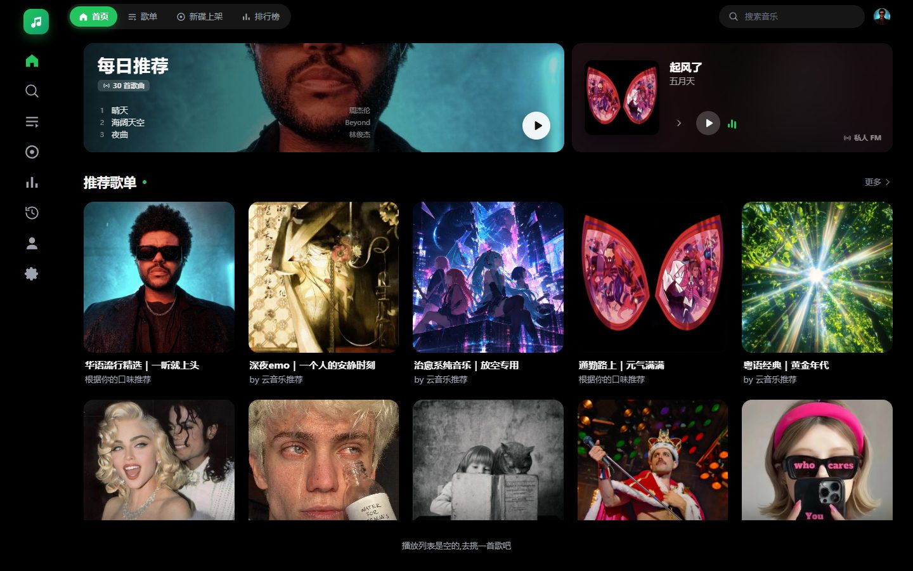
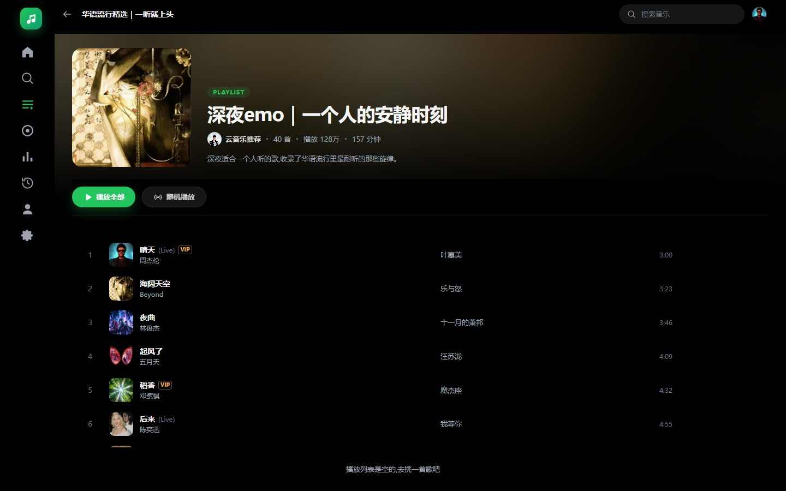
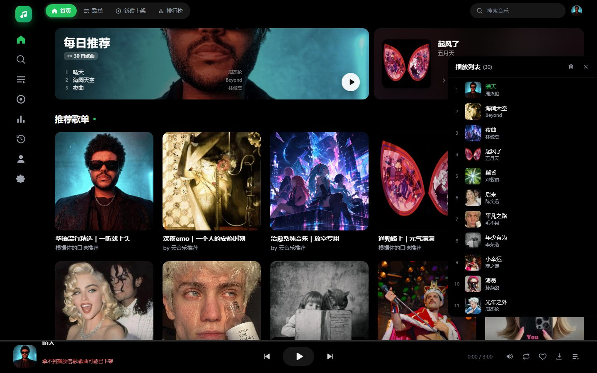
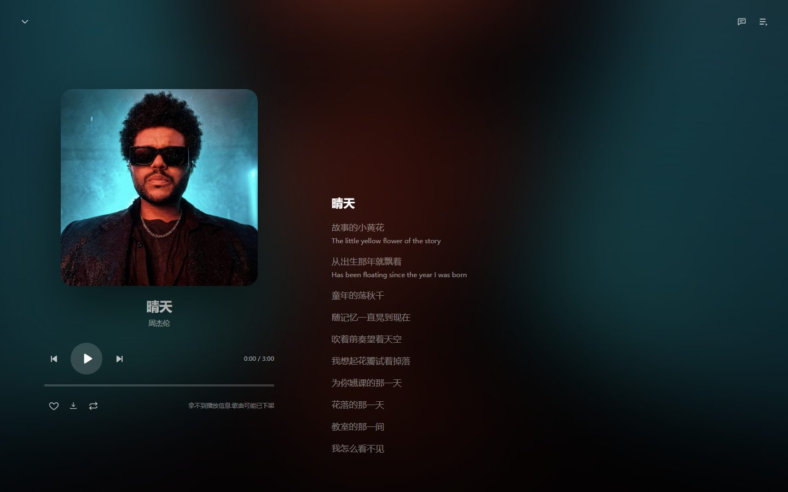

# dsh-plugin-music

**DSH Music** — 内嵌 DeepSeek Harness 的独立音乐播放器插件。UI 按 [AlgerMusicPlayer](https://github.com/algerkong/AlgerMusicPlayer) 5.1(MIT)做 1:1 复刻,去掉原品牌后作为 DSH 原生插件运行;**不依赖本机安装任何播放器**。



- **宿主侧(Node/cordis)**:网易云音乐数据层(`netease-cloud-music-api-alger`)+ 本地 webserver 路由(数据 API + 音频流代理 + 下载落盘)
- **客户端(React,DSH 主区域整页)**:发现 / 歌单广场 / 排行榜 / 新碟上架 / 搜索 / 歌单详情 / 专辑 / 歌手 / 最近播放 / 我的音乐 / 设置,底部常驻播放条
- **播放器**:队列、列表循环 / 单曲循环 / 随机、音量悬浮滑块、倍速、收藏、下载、播放历史、沉浸式歌词页、右键菜单、键盘快捷键
- **附加**:聊天内可直接调用的 4 个工具(`music_search` / `music_song_url` / `music_lyric` / `music_playlist_tracks`)

| 歌单详情 | 播放列表 |
| --- | --- |
|  |  |

| 沉浸式歌词 | 歌单广场 |
| --- | --- |
|  |  |

## 安装

### 手动(推荐,当前未发布 npm)

编辑 `~/.dsh/profiles/desktop/package.json`:

```json
"dependencies": {
  "dsh-plugin-music": "file:C:/path/to/dsh-my-music"
},
"dsh": {
  "profile": {
    "bundles": ["@deepseek-ai/dsh-base", "@deepseek-ai/dsh-web-app", "dsh-plugin-music"]
  }
}
```

然后在该目录 `pnpm install`,重启 DSH;左侧图标栏会出现「音乐」。

### 发布后

```bash
dsh plugin --profile desktop add dsh-plugin-music
```

## 配置(`~/.dsh/profiles/desktop/cordis.patch.yml`)

```yaml
- id: music
  config:
    cookie: 'MUSIC_U=xxxxxxxx'   # 可选兜底;界面扫码登录/退出后不再起作用
    requestTimeoutMs: 15000
    defaultLevel: standard       # 音频代理默认音质
    downloadDir: 'C:/Users/you/Music/DSH'  # 客户端下载目录,必须是绝对路径;留空用 ~/Music/DSH
```

## 功能

### 发现

- 每日推荐大卡(封面取色背景 + 前三首预览 + 一键播放)
- 登录后右侧为「私人 FM」卡(播放/暂停、换一首),未登录为热门歌单 2×2 封面墙
- 推荐歌单(悬停显示前三首曲目与播放按钮)、热门歌手横向滚动、新碟上架、新歌速递

### 歌单 / 排行榜 / 新碟

- 歌单广场按分类浏览(分类横向滚动),滚动到底自动加载下一页
- 排行榜 / 新碟上架按地区切换,卡片悬停显示播放量与更新频率

### 详情页

- 歌单:模糊封面背景 + 大封面 + 创建者/曲目数/播放量/总时长/简介;播放全部、随机播放
- 专辑:发行时间、唱片公司、简介、曲目表
- 歌手:圆形头像、简介、热门 50 首、专辑网格

### 播放器

- 播放条:顶部进度条(可点按/拖动,悬停显示时间)、封面悬停展开详情、歌名/歌手、上一首/播放/下一首、音量悬浮竖滑条(支持滚轮)、播放模式、收藏、下载、播放列表
- 播放列表抽屉:350px 右侧浮层,当前曲目高亮、单曲移除、清空确认
- 沉浸式播放页:封面模糊背景、大封面、迷你控制条、逐行歌词(当前行高亮、点击跳转、翻译开关、字号)
- 右键菜单:播放、下一首播放、收藏、查看专辑/歌手、下载
- 快捷键:空格播放/暂停、←/→ ±5 秒、↑/↓ 音量、Esc 关闭浮层(输入框内不拦截)
- 收藏与播放历史本地持久化;登录后收藏会顺带同步到网易云「我喜欢的音乐」

### 搜索

- 热搜榜(前三条高亮)、搜索历史、输入联想
- 单曲 / 歌单 / 专辑 / 歌手四类结果;单曲支持播放全部

### 账号

- 设置 → 账号 → 扫码登录(等待扫码 → 已扫码待确认 → 自动刷新)
- 二维码由宿主按网易云授权链接实时绘制;登录态写入 `~/.dsh/music-cookie.json`,无需重启即对全部接口与音频代理生效
- 未登录可播标准音质/试听;VIP 歌曲需要登录会员账号

## 下载

播放条、歌曲行悬停区、右键菜单都有下载入口,走宿主 `/music/api/download`:按当前音质解析直链后由 Node 落盘,先写 `.part` 再改名;文件名中的 `/ \ * ? " < > |` 与 `..` 一律清洗,写入不会逃出 `downloadDir`。未登录或非会员时 VIP 曲目只能拿到试听片段,文件名会带 `(试听)` 后缀,下载完成的提示里也会标注。

落盘目录默认 `~/Music/DSH`(可用插件配置 `downloadDir` 改成任意绝对路径)。下载完成的提示条带「打开目录」按钮,点击即在系统文件管理器里定位到刚下好的文件;设置 → 存储 里可以看到完整路径、最近下载的文件列表,并支持逐个「定位」:

## 开发

```bash
npm install
npm run build   # esbuild 打包 src/client.jsx → lib/client.js(ModuleLoader 工厂格式,CSS 内联)
npm test        # 冒烟:工具 + 全部 /music/api/* + 音频流 Range + 下载落盘 + 扫码登录状态机(真实网络)
```

### 本地视觉校验

`design/render-test/` 内置一套 mock 宿主 API 的渲染页,可以脱离 DSH 直接看各个页面(截图在 `design/shots/`):

```bash
npm run preview:build
cd design/render-test && python -m http.server 8391
# 打开 http://127.0.0.1:8391/preview.html?scene=home
```

`scene` 可选:`home` / `list` / `toplist` / `search` / `search-result` / `playlist` / `album` / `artist` / `user` / `settings` / `queue` / `full` / `context` / `queue-next` / `fav`;加 `&guest=1` 可看未登录首页。`queue-next` 会演示「下一首播放」后的队列顺序,`fav` 会弹出「取消全部收藏」确认框。

队列与播放模式的逻辑抽在 `src/ui/queue.js`(纯函数,不依赖 React/DOM),由冒烟测试直接覆盖:`insertNext`(下一首播放的插位)、`nextIndex`(列表/单曲/随机)、`prevIndex`、`shuffled`。抽出来的原因是这些下标运算很容易在重构中悄悄改错,而纯函数可以被 Node 直接断言。

### 三条已被冒烟测试守住的约束

- `src/ui` 里只能用静态 `import` 引入本地模块。构建参数 `minifyIdentifiers: false` 下,esbuild 会把动态引入的解构变量编译成未改名的自由引用,运行期 `ReferenceError` 又被 `.catch` 吞掉,现象是「歌词永远空白」。
- 歌词取经典 `lyric` 接口(带 `_nmclfl`)而不是 `lyric_new`:后者把头部若干行返回成 JSON 富文本,纯音乐/逐字歌词缺失时反而整段丢行。
- 进度条(SeekBar)的交互层必须是**铺满的透明原生 `<input type="range">`**,只通过 `onChange` 取值。DSH 宿主会在 document/window 上挂指针监听(输入模态、点击外部关闭浮层),任何自定义 pointer 逻辑在宿主里都不可靠;原生 range 由浏览器内建控件处理点按/拖动,实测在宿主的 document 捕获阶段 `stopPropagation` 之下依然生效。

### 桌面端调试提示

DSH 的插件客户端 bundle 由 `dsh-client-modules` 提供,URL 按文件的 `mtime/ctime/size` 生成 `rev`,响应头是 `cache-control: public, max-age=31536000, immutable`。也就是**改了 `lib/client.js` 之后,只在页面里切换/刷新不一定能拿到新包**,请完全退出 DeepSeek Harness(托盘 → 退出)再重开。判断是否加载了新包:把鼠标悬停到播放条进度条上,提示文字带当前版本号(如 `v1.0.3`),或看 设置 → 关于 的版本号。

## 架构

```
DSH 桌面端
├─ 宿主插件 lib/index.js
│   ├─ /music/api/*        数据接口(见下)
│   ├─ /music/stream/:id   音频流代理(Range 透传,<audio> 直接指向此处)
│   └─ 4 个 agent 工具
└─ 客户端 lib/client.js(React,slots: main + sidebar.panellist)
    └─ 与宿主同源通信(无需 CORS),音频走本地代理解决混合内容
```

宿主接口一览:

| 路由 | 说明 |
| --- | --- |
| `/api/home` | 首页聚合(每日推荐 / 推荐歌单 / 热门歌手 / 新碟 / 新歌),单个板块失败不影响整页 |
| `/api/playlists`、`/api/playlists/categories` | 歌单广场分类与分页 |
| `/api/playlist/detail`、`/api/playlist/tracks` | 歌单详情与全部曲目 |
| `/api/toplists`、`/api/toplist/tracks` | 榜单列表与曲目 |
| `/api/album/new`、`/api/album/detail` | 新碟与专辑详情 |
| `/api/artist/top`、`/api/artist/detail`、`/api/artist/albums` | 歌手 |
| `/api/search`、`/api/search/hot`、`/api/search/suggest` | 搜索(结构化字段 + 旧版 detail 摘要) |
| `/api/song/detail`、`/api/song/urls`、`/api/lyric` | 曲目元数据、直链、歌词 |
| `/api/personal/fm`、`/api/user/playlists`、`/api/like` | 私人 FM、我的歌单、喜欢 |
| `/api/download` | 下载落盘 |
| `/api/download/info` | 下载目录与最近落盘的音频文件(供设置页「存储」展示) |
| `/api/download/open` | 在系统文件管理器里打开下载目录;带 `name` 时精确选中该文件(越界路径退化为打开目录) |
| `/api/account`、`/api/login/qr/*`、`/api/logout` | 账号与扫码登录 |

数据层对网易云接口的网络类错误(TLS 断连 / 5xx)会重试两次,避免个别板块偶发空白。

## 免责声明

UI 结构复刻自 AlgerMusicPlayer(MIT,感谢原作者 algerkong);数据依赖社区维护的第三方接口库,仅供个人学习研究。音乐内容版权归网易云及版权方所有,请遵守当地法律,勿用于商业用途。不包含任何音源解锁组件。

## License

MIT
